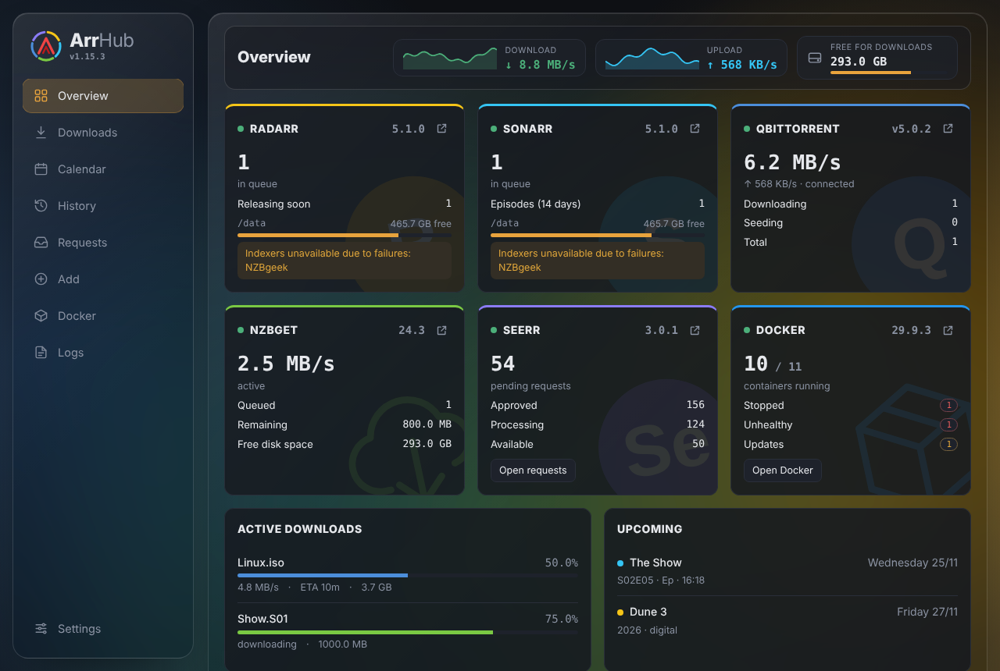
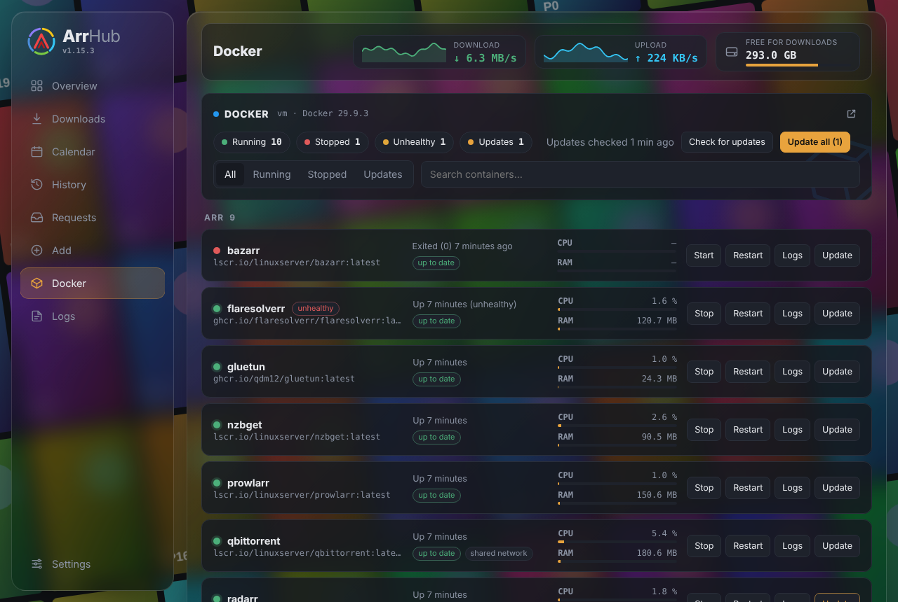
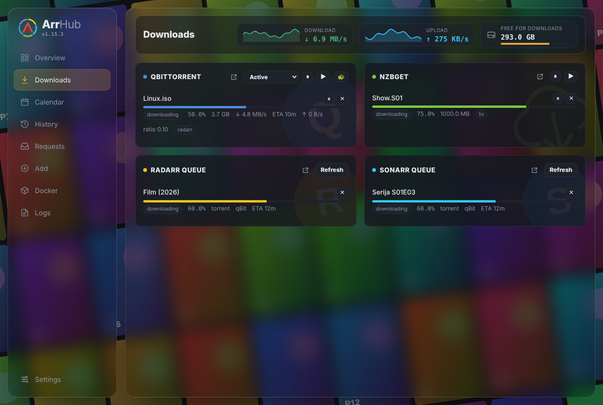

## What's new in 1.16.0
- **Live header on every tab** – the speeds moved from the menu into the header of the glass panel:
  - **download** and **upload**, each with **its own graph** of the last minutes
  - **free for downloads** – the free space where qBittorrent and NZBGet save, the smaller of the two (it fills up first); hover for both values, turns red when space runs low
  - qBittorrent's free space is read incrementally (`/sync/maindata` with `rid`), so it costs almost nothing per refresh
- **Docker tab layout** – CPU and RAM share one column so the actions stay on one line on 1280 px screens
- **New screenshots** in the README



## Everything since 1.13 – all fixes included
- **1.13.0 – Glass layout:** menu on the left, frosted 70 % transparent glass behind the cards, ☰ menu on phones
- **1.14.0 – Docker control:** every container with state, health, CPU/RAM, ports and update status; start / stop / restart, logs, one-click updates with automatic rollback, containers sharing a VPN container's network recreated with it
- **1.15.0 – Docker over SSH:** `ssh://user@host`, generated key pair restricted to `docker system dial-stdio`, no open port needed
- **1.15.1** – the socket-proxy 403 error names the exact switch to turn on
- **1.15.2** – fixed *Premature close* when updating containers over SSH
- **1.15.3** – container logs through the linuxserver socket proxy need `ALLOW_LOGS=1` (README and error message)



## Upgrade

**Docker**
```bash
docker pull ghcr.io/moordrak/arrhub:1.16.0   # or :latest
docker compose up -d                           # if you use docker-compose.yml
```

**Proxmox LXC** (on the Proxmox host)
```bash
pct exec <CTID> -- bash -c "$(curl -fsSL https://raw.githubusercontent.com/moordrak/arrhub/main/install.sh)"
```

**Debian / Ubuntu**
```bash
bash -c "$(curl -fsSL https://raw.githubusercontent.com/moordrak/arrhub/main/install.sh)"
```

Your existing `config.json` is kept. Reload the page once after upgrading (Ctrl+F5).

**Full changelog:** https://github.com/moordrak/arrhub/compare/v1.13.0...v1.16.0
