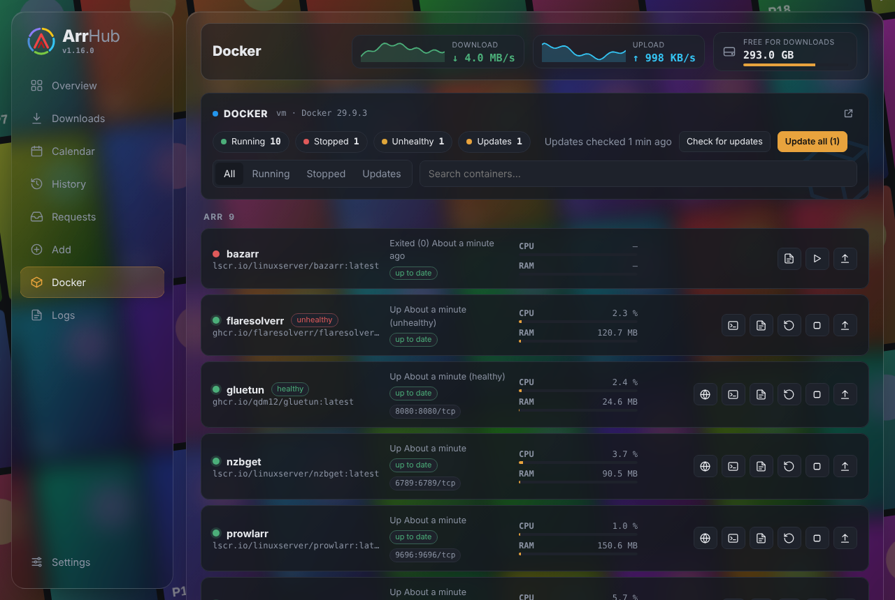

## What's new
- **Open a container's web page** – containers with a published TCP port get a 🌐 button that opens the app (Radarr, Sonarr, Jellyfin, …) in a window over ArrHub, with *Open in new tab* and reload. Several ports → pick one in the window. A `arrhub.url` or `homepage.href` label on the container sets the address explicitly.
  - apps that forbid being shown inside another page (`X-Frame-Options` / CSP, e.g. qBittorrent's clickjacking protection) and `http://` pages while ArrHub runs on `https://` are detected and offered in a new tab instead of showing a blank window
  - links use the host of your Docker address; set *Settings → Docker → Address for opening containers* (`ARRHUB_DOCKER_WEB_HOST`) if they should use another one
- **Terminal into a container** – a real terminal (xterm.js) **inside** the container via `docker exec` – bash if the image has it, otherwise sh – e.g. directly in Radarr, not on the Docker host. Colours, full-screen tools and resizing work; it follows the window size, also on phones.
  - works over every connection type: socket proxy (add `EXEC=1`), TLS, SSH and the local socket
  - clear messages for stopped containers, images without a shell and a proxy without `EXEC`
- **Docker rows** – actions are now compact icon buttons with tooltips and the columns line up across rows



### Notes
- The terminal gives a root shell in any running container – it is only available with the ArrHub login set up the way you want, and with a socket proxy only if you add `EXEC=1`.
- Behind Nginx Proxy Manager, turn on **Websockets Support** for the ArrHub proxy host, otherwise the terminal cannot connect.
- xterm.js (MIT) is bundled in `public/vendor`, so ArrHub still has no dependencies and loads nothing from the internet.

## Upgrade

**Docker**
```bash
docker pull ghcr.io/moordrak/arrhub:1.17.0   # or :latest
docker compose up -d                           # if you use docker-compose.yml
```

**Proxmox LXC** (on the Proxmox host)
```bash
pct exec <CTID> -- bash -c "$(curl -fsSL https://raw.githubusercontent.com/moordrak/arrhub/main/install.sh)"
```

**Debian / Ubuntu**
```bash
bash -c "$(curl -fsSL https://raw.githubusercontent.com/moordrak/arrhub/main/install.sh)"
```

Your existing `config.json` is kept. Reload the page once after upgrading (Ctrl+F5).

**Full changelog:** https://github.com/moordrak/arrhub/compare/v1.16.0...v1.17.0
