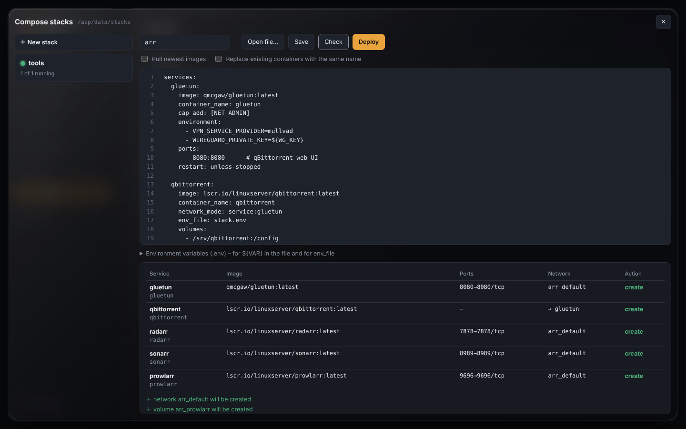
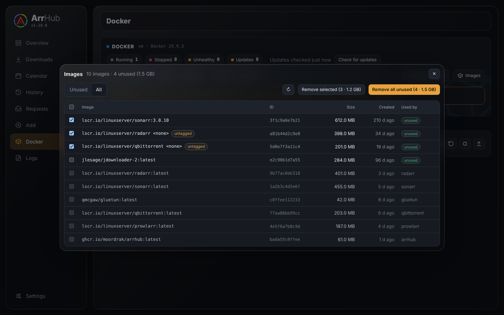

## What's new

### Compose stacks
A **Compose stacks** button in the Docker tab opens an editor for `docker-compose.yml` – paste a file (or open one), name the stack and deploy it.



- **Check** shows every service with its image, ports and network and whether it will be *created*, *recreated*, *replaced* or stay *unchanged*, plus new networks and volumes and services that will be removed
- **Deploy** creates networks, volumes and containers in `depends_on` order (waits for `service_healthy` / `service_completed_successfully`), starts them and checks that they keep running. Deploying again recreates only what changed – including containers that share a changed container's network (`network_mode: service:gluetun`)
- no `docker compose` needed on the Docker host – ArrHub does it through the Docker API, over every connection type (socket proxy, TLS, SSH). Containers get the usual compose labels and are grouped by stack
- **.env field** for `${VAR}`, `${VAR:-default}`, `${VAR:?error}` and `env_file:` (like Portainer's `stack.env`)
- **Take over Portainer stacks:** they are listed under *Other compose projects* – paste their file and deploy, unchanged containers keep running
- start, stop, restart, *Stop & remove containers* (optionally with volumes) and delete per stack; option *Pull newest images*
- a YAML error points to the line in the editor; Tab/Shift+Tab indent, Ctrl+S saves
- containers of other stacks or without a stack are replaced only with *Replace existing containers*; ArrHub's own container is never touched
- not supported: `build:`, `secrets:`/`configs:` and relative paths (`./config` → write `/srv/app/config`) – shown as clear errors or warnings

### Unused images
An **Images** button lists all images with size, age and the containers that use them. Remove the selected ones or **all unused** with one click – images used by any container (also stopped ones) are never removed.



### Other
- the ✕ in the web page, terminal and new windows is now aligned to the right

**Socket proxy users:** compose stacks with named volumes need `VOLUMES=1` (besides `CONTAINERS`, `IMAGES`, `NETWORKS`, `POST`, `ALLOW_START`, `ALLOW_STOP`, `ALLOW_RESTARTS`). If something is missing, ArrHub says which variable to add.

## Upgrade

**Docker**
```bash
docker pull ghcr.io/moordrak/arrhub:1.19.0   # or :latest
docker compose up -d                           # if you use docker-compose.yml
```

**Proxmox LXC** (on the Proxmox host)
```bash
pct exec <CTID> -- bash -c "$(curl -fsSL https://raw.githubusercontent.com/moordrak/arrhub/main/install.sh)"
```

**Debian / Ubuntu**
```bash
bash -c "$(curl -fsSL https://raw.githubusercontent.com/moordrak/arrhub/main/install.sh)"
```

Your existing `config.json` is kept; stacks are saved in `stacks/` next to it.

**Full changelog:** https://github.com/moordrak/arrhub/compare/v1.18.0...v1.19.0
