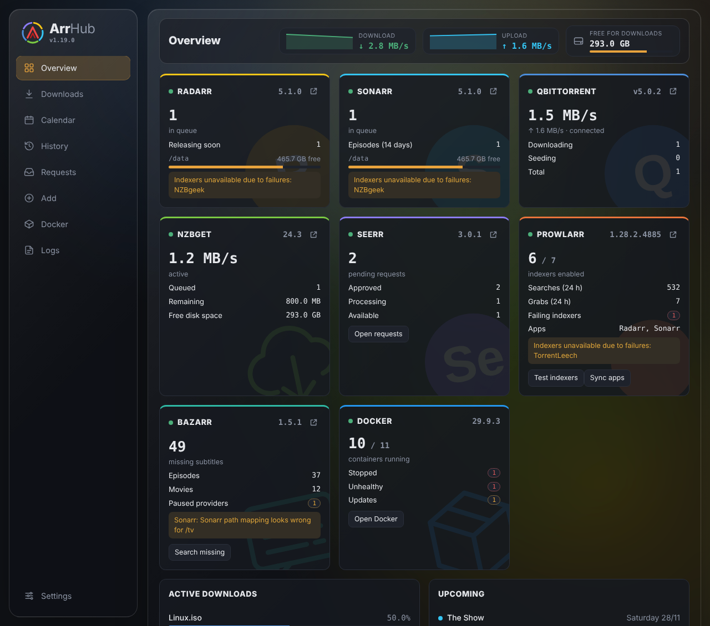

## What's new

Two new services: **Prowlarr** and **Bazarr**. Add them in **Settings** (URL + API key from *Settings → General → Security* of each app) and click *Test connection*.



### Prowlarr
- **Overview card:** enabled indexers, searches and grabs in the last 24 h, **failing indexers** (the ones Prowlarr disabled after errors), connected apps and health warnings
- **Test indexers** – tests every enabled indexer and tells which ones don't work; **Sync apps** – pushes the indexers to Radarr/Sonarr
- **History:** searches (with result count, app and response time), RSS and grabs, with paging
- **Logs** tab: Prowlarr's log

### Bazarr
- **Overview card:** missing subtitles for episodes and movies, providers Bazarr paused (e.g. after too many requests – with retry time) and health warnings
- **Search missing** – starts Bazarr's search for all missing subtitles
- **History:** downloaded, upgraded, manual, synced and deleted subtitles for episodes and movies together, with language, provider and score
- **Logs** tab: Bazarr's log

Both also get the ↗ link, their own icon on the card, the *Accept self-signed certificate* option, Docker container recognition (https address in the web window) and the environment variables `PROWLARR_URL`, `PROWLARR_KEY`, `PROWLARR_LINK`, `PROWLARR_INSECURE`, `BAZARR_URL`, `BAZARR_KEY`, `BAZARR_LINK`, `BAZARR_INSECURE`. The installers ask for them too.

## Upgrade

**Docker**
```bash
docker pull ghcr.io/moordrak/arrhub:1.20.0   # or :latest
docker compose up -d                           # if you use docker-compose.yml
```

**Proxmox LXC** (on the Proxmox host)
```bash
pct exec <CTID> -- bash -c "$(curl -fsSL https://raw.githubusercontent.com/moordrak/arrhub/main/install.sh)"
```

**Debian / Ubuntu**
```bash
bash -c "$(curl -fsSL https://raw.githubusercontent.com/moordrak/arrhub/main/install.sh)"
```

Your existing `config.json` is kept.

**Full changelog:** https://github.com/moordrak/arrhub/compare/v1.19.0...v1.20.0
