<p align="center">
  <picture>
    <source media="(prefers-color-scheme: dark)" srcset="docs/logo-wordmark-dark.svg">
    
  </picture>
</p>

<p align="center"><a href="README.md">English</a> · <b>Hrvatski</b></p>

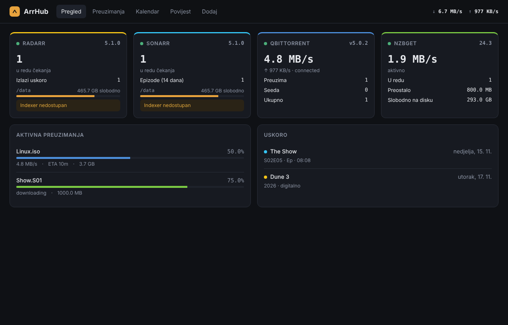

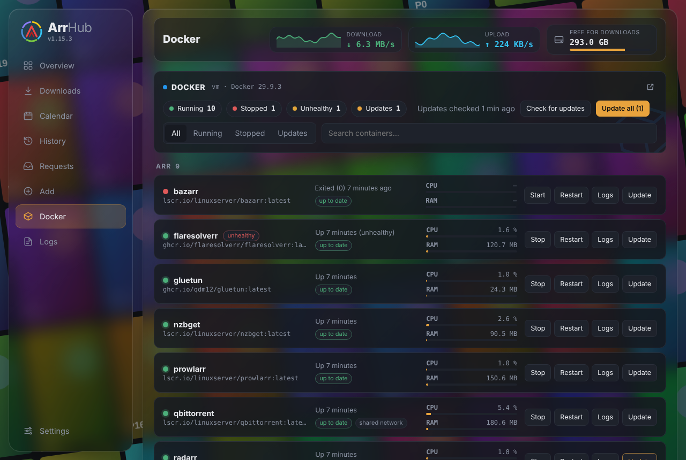

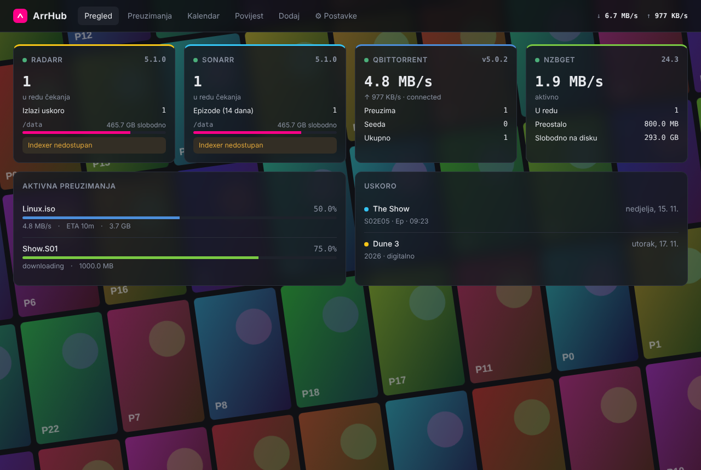

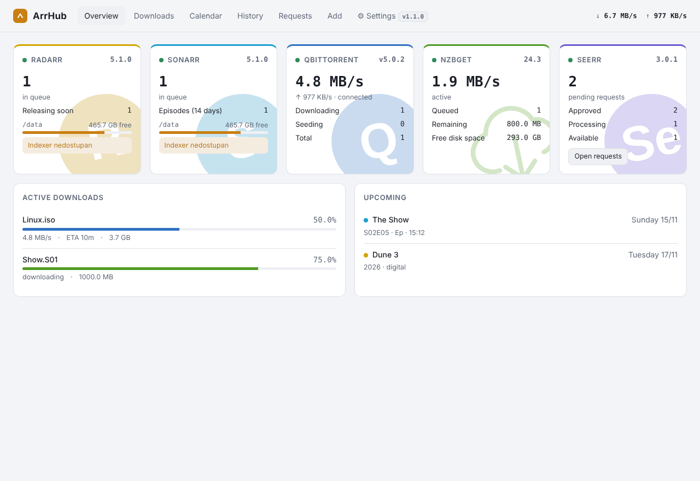

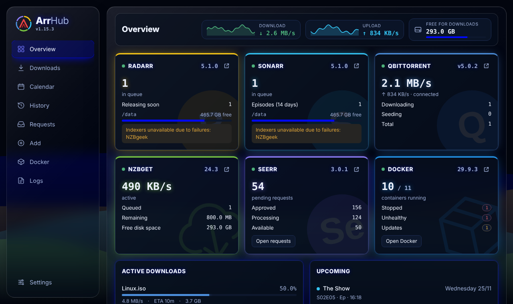

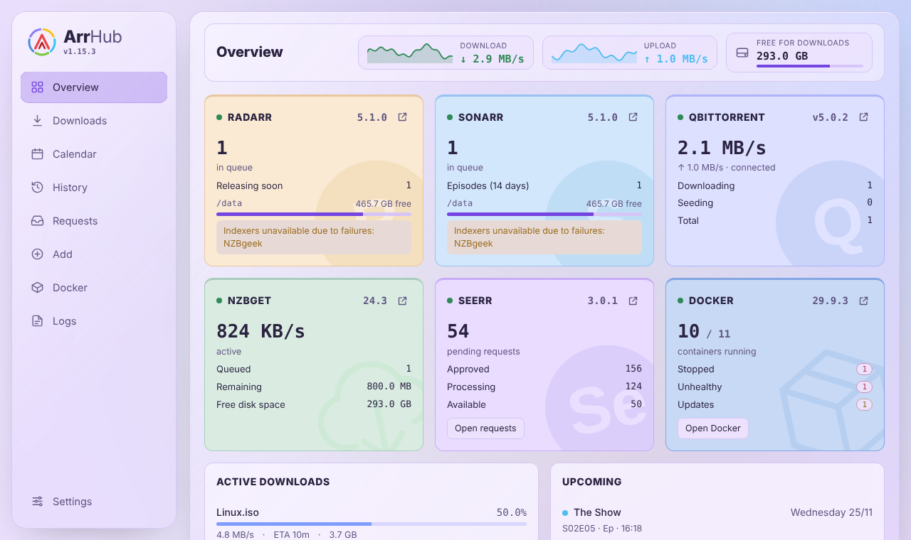

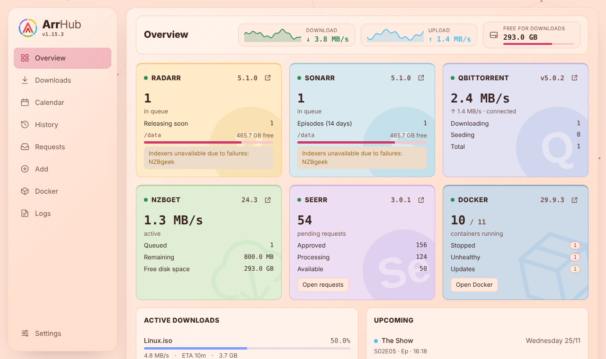

Jedinstvena web nadzorna ploča za **Radarr, Sonarr, NZBGet, qBittorrent, Seerr, Prowlarr i Bazarr**.
Mali Node.js poslužitelj (bez ovisnosti, Node 18+) drži API ključeve i lozinke na strani poslužitelja
i prosljeđuje pozive, pa preglednik nikad ne vidi tajne i nema CORS problema.

## Mogućnosti
- **Pregled** – stanje svih usluga, verzije, brzine, slobodan prostor, health upozorenja, aktivna preuzimanja i nadolazeća izdanja
- **Preuzimanja** – qBittorrent (filter, pauza/pokretanje, brisanje s/bez datoteka, alt. ograničenje brzine),
  NZBGet (pauza/nastavak po stavci i globalno, brisanje), Radarr/Sonarr red čekanja (uklanjanje + blocklist)
- **Zahtjevi (Seerr)** – zahtjevi korisnika s posterom, sezonama i stanjem, filtri (na čekanju, svi, u obradi, dostupni, odbijeni),
  odobravanje, odbijanje i brisanje. Broj zahtjeva na čekanju vidi se i u Pregledu. Radi i s Overseerrom i Jellyseerrom.
- **Poveznice na svaki servis** – svaka kartica ima gumb ↗ koji otvara web sučelje servisa u novoj kartici. Zadano vodi na URL servisa, a u Postavkama se za svaki servis može upisati zasebna javna poveznica (npr. adresa preko reverse proxyja)
- **Samopotpisani certifikati** – za servis na `https://` sa samopotpisanim ili lokalno potpisanim certifikatom uključi *Prihvati samopotpisani certifikat* u Postavkama. Provjera se preskače samo za adresu tog servisa; sve ostalo (npr. provjera ažuriranja na GitHubu) i dalje provjerava certifikate
- **Prowlarr** – uključeni indekseri i oni s greškom, pretrage i preuzimanja u zadnja 24 h, spojene aplikacije i upozorenja; gumbi *Testiraj indeksere* i *Sinkroniziraj aplikacije*; povijest pretraga i preuzimanja
- **Bazarr** – nedostajući titlovi za epizode i filmove, pružatelji koje je Bazarr pauzirao (npr. nakon previše zahtjeva) i upozorenja; *Traži nedostajuće* pokreće Bazarrovu pretragu; povijest preuzetih, poboljšanih i sinkroniziranih titlova
- **Bez interneta** – Postavke → *Mreža*: ArrHub tada razgovara samo s tvojim servisima – nema provjere verzije ni slika s TMDB-a/TVDB-a; posteri dolaze iz Radarra/Sonarra i Seerrove predmemorije slika (također `ARRHUB_OFFLINE=true`)
- **Zaglavlje uživo** – svaki tab prikazuje brzinu preuzimanja i slanja, svaku sa svojim grafom zadnjih minuta, i slobodan prostor gdje klijenti za preuzimanje spremaju
- **Upravljanje Dockerom** – svi kontejneri na Docker hostu sa stanjem, zdravljem, CPU/RAM-om i statusom ažuriranja; pokretanje, zaustavljanje, restart, logovi i ažuriranje jednim klikom s automatskim vraćanjem, **compose editor** u koji zalijepiš `docker-compose.yml` i pokreneš ga te čišćenje nekorištenih image-a (vidi [Upravljanje Dockerom](#upravljanje-dockerom))
- **Stakleni izgled** – izbornik lijevo i zamućena, 70 % prozirna staklena ploča iza pločica kroz koju se vidi dinamička pozadina; na mobitelu se izbornik otvara gumbom ☰
- **Logovi** – log ArrHuba i logovi Radarra, Sonarra, qBittorrenta, NZBGeta, Seerra, Prowlarra i Bazarra u jednom tabu, s filtrom razine, pretragom, automatskim osvježavanjem i preuzimanjem
- **Vlastiti CA certifikat** – zalijepi certifikat svog izdavatelja (PEM) u Postavke → *SSL / TLS* i ArrHub će njime potpuno provjeravati tvoje `https://` servise, uključujući ime. Također `ARRHUB_CA` (PEM tekst) ili `ARRHUB_CA_FILE` (putanja do .crt/.pem)
- **Kalendar** – filmovi i epizode za sljedeća 2 tjedna
- **Povijest** – zadnji događaji iz Radarra, Sonarra, NZBGeta, qBittorrenta, Prowlarra (pretrage, preuzimanja) i Bazarra (titlovi)
- **Dodaj** – pretraga i dodavanje filmova/serija (odabir profila kvalitete i mape, opcionalno odmah traži)
- **Postavke** – adrese, API ključevi i lozinke usluga, prijava u ArrHub, interval osvježavanja i port, sve kroz sučelje.
  Gumb *Testiraj vezu* provjerava svaku uslugu prije spremanja, a promjene vrijede odmah, bez ponovnog pokretanja.
- **Teme i dinamičke pozadine** (u Postavkama): 13 tema (uključujući Matrix, Neon sa sjajem i dvije šarene pastelne teme) + automatska (prati svijetli/tamni način sustava), vlastita
  naglasna boja te animirane pozadine *Aurora, Zvjezdano nebo, Mreža čestica, Valovi, Zid postera* i *Slike iz knjižnice*.
  Zadnje dvije koriste postere i pozadinske slike iz Radarra/Sonarra (dohvaća ih ArrHub, nije potreban internet).
  Animacija se po želji ubrzava s brzinom preuzimanja, a poštuje i postavku sustava „smanji pokrete”.
- **Ikone servisa na karticama**: velika, prigušena ikona servisa iza svake kartice. ArrHub preuzima službenu ikonu s tvoje
  instance Radarra/Sonarra/qBittorrenta/NZBGeta/Seerra/Prowlarra/Bazarra (zamjena je generička ikona), uz prekidač i klizač jačine u Postavke → Izgled
- **Jezik**: engleski ili hrvatski (ili automatski prema pregledniku), bira se u Postavkama → Izgled
- Automatsko osvježavanje (zadano 5 s), opcionalna Basic Auth prijava
- Podržava qBittorrent 4.x i 5.x (stop/start i pause/resume)

## Postavljanje
```bash
node server.js                       # http://<ip>:8686
```
Otvori stranicu: ako nijedna usluga nije podešena, odmah se otvara kartica **⚙ Postavke**. Upiši adrese i ključeve,
klikni *Testiraj vezu* i *Spremi postavke*. Postavke se spremaju u `config.json` (prava 600). Lozinke i ključevi se u
sučelju nikad ne prikazuju: polje s `********` znači da se postojeća vrijednost zadržava.

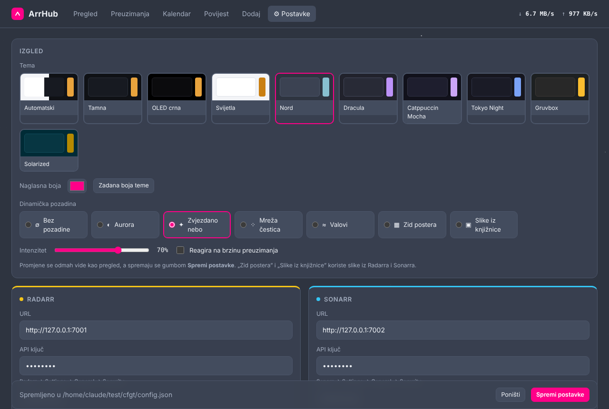

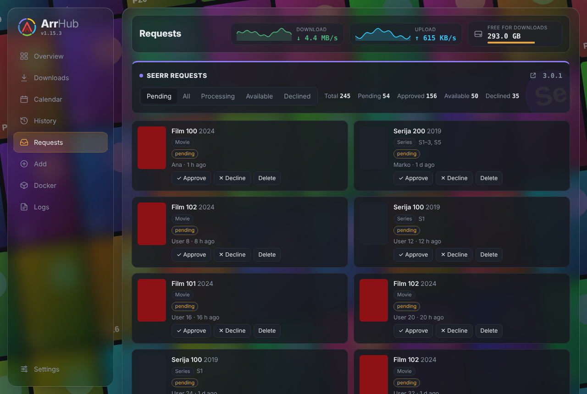

Umjesto sučelja možeš i ručno urediti `config.json` (predložak je `config.example.json`) i ponovno pokrenuti servis.
Sve se može zadati i varijablama okruženja: `PORT, ARRHUB_REFRESH, ARRHUB_USER, ARRHUB_PASS, RADARR_URL, RADARR_KEY,
SONARR_URL, SONARR_KEY, NZBGET_URL, NZBGET_USER, NZBGET_PASS, QBIT_URL, QBIT_USER, QBIT_PASS, SEERR_URL, SEERR_KEY, PROWLARR_URL, PROWLARR_KEY, BAZARR_URL, BAZARR_KEY`,
za poveznice u karticama `RADARR_LINK, SONARR_LINK, NZBGET_LINK, QBIT_LINK, SEERR_LINK, PROWLARR_LINK, BAZARR_LINK`,
za samopotpisane certifikate `RADARR_INSECURE, SONARR_INSECURE, NZBGET_INSECURE, QBIT_INSECURE, SEERR_INSECURE, PROWLARR_INSECURE, BAZARR_INSECURE` (`true`/`false`),
vlastiti CA `ARRHUB_CA` (PEM) ili `ARRHUB_CA_FILE` (putanja),
način bez interneta `ARRHUB_OFFLINE` (`true`/`false`),
Docker `ARRHUB_DOCKER_URL`, `ARRHUB_DOCKER_SSH_KEY` / `ARRHUB_DOCKER_SSH_KEY_FILE`, `ARRHUB_DOCKER_CERT_PATH` (ili `ARRHUB_DOCKER_CA`, `ARRHUB_DOCKER_CERT`, `ARRHUB_DOCKER_KEY`), `ARRHUB_DOCKER_CLEANUP`, `ARRHUB_DOCKER_LINK`, `ARRHUB_DOCKER_WEB_HOST`, Nginx Proxy Manager `ARRHUB_NPM_URL`, `ARRHUB_NPM_USER`, `ARRHUB_NPM_PASS`, a za izgled
`ARRHUB_THEME, ARRHUB_ACCENT, ARRHUB_BACKGROUND, ARRHUB_BG_INTENSITY, ARRHUB_BG_REACTIVE, ARRHUB_LANG` (`en`, `hr`, `auto`),
`ARRHUB_CARD_ICONS` (`true`/`false`), `ARRHUB_CARD_ICON_STRENGTH` (3–30). One imaju prednost pred
datotekom, pa su takva polja u Postavkama zaključana. Putanju datoteke mijenja `ARRHUB_CONFIG`.

> ⚠ Bez prijave svatko tko može otvoriti ArrHub može i mijenjati postavke. Ako je dostupan izvan LAN-a, uključi prijavu.

### Proxmox — automatska instalacija (preporučeno)
Na Proxmox hostu, kao root:
```bash
bash -c "$(curl -fsSL https://raw.githubusercontent.com/moordrak/arrhub/main/proxmox/arrhub-lxc.sh)"
```
Skripta pita za postavke kontejnera (ID, RAM, disk, storage, bridge, VLAN, statična IP ili DHCP) i
za adrese i ključeve usluga. Zatim stvara neprivilegirani Debian LXC (Debian 13 na PVE 9+, inače 12),
instalira Node.js i ArrHub te ga pokreće kao systemd servis. Usluge koje ne koristiš preskoči s Enter. Sve se kasnije može promijeniti u Postavkama.

Bez pitanja, npr. za automatizaciju:
```bash
NONINTERACTIVE=1 CTID=120 CT_IP=192.168.1.50/24 CT_GW=192.168.1.1 \
RADARR_URL=http://192.168.1.10:7878 RADARR_KEY=xxx \
QBIT_URL=http://192.168.1.10:8080 QBIT_USER=admin QBIT_PASS=xxx \
bash proxmox/arrhub-lxc.sh
```
Varijable kontejnera: `CTID, CT_NAME, CT_CORES, CT_RAM, CT_DISK, CT_STORAGE, TPL_STORAGE, CT_BRIDGE, CT_VLAN, CT_IP, CT_GW, CT_PASS`.

### Postojeći LXC ili Debian/Ubuntu poslužitelj
Unutar kontejnera ili na poslužitelju, kao root:
```bash
bash -c "$(curl -fsSL https://raw.githubusercontent.com/moordrak/arrhub/main/install.sh)"
```
Instalira u `/opt/arrhub`, stvara korisnika `arrhub` i servis `arrhub.service`.

### Nadogradnja
Ponovno pokreni `install.sh` (postojeći `config.json` se zadržava). S Proxmox hosta:
```bash
pct exec <CTID> -- bash -c "$(curl -fsSL https://raw.githubusercontent.com/moordrak/arrhub/main/install.sh)"
```

### Ručno (systemd)
```bash
useradd -r -s /usr/sbin/nologin arrhub
mkdir -p /opt/arrhub && cp -r server.js compose.js package.json lib public config.json /opt/arrhub/
chown -R arrhub: /opt/arrhub && chmod 600 /opt/arrhub/config.json
cp arrhub.service /etc/systemd/system/ && systemctl enable --now arrhub
```

### Docker
Gotove slike za amd64 i arm64 objavljuju se u GitHub Container Registryju:
```bash
docker run -d --name arrhub --restart unless-stopped \
  -p 8686:8686 -v arrhub-data:/app/data \
  ghcr.io/moordrak/arrhub:latest
```
ili s Composeom (`docker-compose.yml` u repozitoriju):
```bash
docker compose up -d
```
Konfiguracija se čuva u volumenu `arrhub-data` (`/app/data/config.json`) i uređuje se kroz Postavke.

Oznake: `latest` (zadnji release), `1.0.0` / `1.0` / `1` (verzije), `edge` (zadnji commit na `main`).

Releaseovi su automatski: povećaj `version` u `package.json` (po želji dodaj bilješke u `.github/releases/vX.Y.Z.md`) i pushaj na `main` –
workflow izgradi slike, stvori tag `vX.Y.Z` i objavi GitHub release.
Za vlastitu izgradnju: `docker build -t arrhub .`

### Nginx Proxy Manager
Dodaj Proxy Host → `http://<ip-lxc>:8686`. Ako je dostupno izvan LAN-a, obavezno uključi
`auth` u config.json ili Access List u NPM-u – ploča može brisati i dodavati sadržaj.

## Upravljanje Dockerom

Tab **Docker** prikazuje sve kontejnere na tvom Docker hostu – grupirane po compose projektu – sa stanjem, zdravljem, vremenom rada, procesorom i RAM-om, portovima i oznakom ima li novija verzija image-a. Kontejnere možeš pokretati, zaustavljati i ponovno pokretati, čitati njihove logove te ih **ažurirati** jedan po jedan ili sve odjednom.

**Ažuriranje** radi kao Watchtower, ali samo kad ti klikneš: Docker host preuzme novi image, a ArrHub ponovno stvori kontejner s potpuno istim postavkama (varijable okoline, volumeni, mreže i aliasi, portovi, oznake, politika ponovnog pokretanja). Ako novi kontejner ne nastavi raditi (ili javlja da nije zdrav), stari se automatski vraća. Kontejneri koji dijele mrežu drugog kontejnera (npr. qBittorrent iza VPN kontejnera s `network_mode: service:vpn`) ponovno se stvaraju zajedno s njim. Image-i vezani na digest ostaju netaknuti. Provjeru novih verzija radi Docker host, pa ArrHub ni tada ne izlazi na internet u načinu bez interneta.

**Postavljanje (preporuka): socket proxy na Docker hostu.** ArrHubu daje samo one dijelove Docker API-ja koji mu trebaju, umjesto cijelog socketa. Dodaj ga u compose datoteku na Docker VM-u:

```yaml
services:
  socket-proxy:
    image: lscr.io/linuxserver/socket-proxy:latest
    container_name: socket-proxy
    environment:
      - CONTAINERS=1
      - IMAGES=1
      - NETWORKS=1
      - DISTRIBUTION=1
      - INFO=1
      - POST=1
      - ALLOW_START=1
      - ALLOW_STOP=1
      - ALLOW_RESTARTS=1
      - ALLOW_LOGS=1
      - VOLUMES=1         # compose stackovi s imenovanim volumenima
      - EXEC=1            # samo za terminal – makni ako ga ne želiš
    volumes:
      - /var/run/docker.sock:/var/run/docker.sock:ro
    ports:
      - 2375:2375
    read_only: true
    tmpfs:
      - /run
    restart: unless-stopped
```

Zatim u ArrHubu → **Postavke → Docker** upiši `http://<ip-docker-vm-a>:2375` i klikni *Testiraj vezu*. Alternative: `https://<host>:2376` s TLS klijentskim certifikatima (zalijepi `ca.pem`, `cert.pem` i `key.pem` ili postavi `ARRHUB_DOCKER_CERT_PATH`) ili `unix:///var/run/docker.sock` ako ArrHub radi na samom Docker hostu.

**Ili preko SSH-a – bez otvorenog porta.** ArrHub se spaja SSH ključem i na Docker hostu pokreće samo `docker system dial-stdio` (isto što radi `DOCKER_HOST=ssh://…`):

1. U ArrHubu → **Postavke → Docker** upiši `ssh://arrhub@<ip-docker-vm-a>`, otvori *SSH* i klikni **Stvori par ključeva** – ArrHub upiše novi ključ i prikaže gotov redak za `authorized_keys`.
2. Klikni **Kopiraj** ispod tog retka, pa ga na Docker VM-u dodaj korisniku u grupi `docker` – umjesto `OVDJE_ZALIJEPI_REDAK_IZ_ARRHUBA` zalijepi **svoj kopirani redak** (dug je oko 130 znakova i počinje s `command="docker system dial-stdio",restrict ssh-ed25519 AAAAC3Nza…`):
   ```bash
   sudo adduser --disabled-password --gecos "" arrhub && sudo usermod -aG docker arrhub
   sudo install -d -m 700 -o arrhub -g arrhub /home/arrhub/.ssh
   echo 'OVDJE_ZALIJEPI_REDAK_IZ_ARRHUBA' | sudo tee -a /home/arrhub/.ssh/authorized_keys
   sudo chown arrhub:arrhub /home/arrhub/.ssh/authorized_keys && sudo chmod 600 /home/arrhub/.ssh/authorized_keys
   ```
   `command=…` i `restrict` ograničavaju ključ samo na Docker API – njime se ne može otvoriti ljuska ni prosljeđivati portove.
3. Spremi postavke i klikni *Testiraj vezu*.

SSH ključu Docker hosta vjeruje se kod prvog spajanja i pamti se u `docker_known_hosts` pored `config.json`; promijenjeni ključ se odbija. Ključevi s lozinkom nisu podržani. Varijable okoline: `ARRHUB_DOCKER_URL=ssh://…`, `ARRHUB_DOCKER_SSH_KEY` ili `ARRHUB_DOCKER_SSH_KEY_FILE`. Napomena: korisnik u grupi `docker` može sve što može Docker – socket proxy je ograničenija opcija.

**Web stranice i terminal.** Kontejneri s objavljenim TCP portom (ili oznakom `arrhub.url` / `homepage.href`) dobivaju gumb 🌐 koji aplikaciju otvara u prozoru iznad ArrHuba. Aplikacije koje ne dopuštaju prikaz unutar druge stranice (npr. qBittorrent s uključenom zaštitom od clickjackinga) i obične `http://` stranice dok ArrHub radi na `https://` nude se u novoj kartici. Ako poveznice koriste krivu adresu, postavi *Adresa za otvaranje kontejnera* u Postavke → Docker.

**https adrese pronalaze se automatski**, pa preglednik nikad ne mora prikazati `http://` stranicu unutar `https://` ArrHuba:
- **Arr servisi** (Radarr, Sonarr, NZBGet, qBittorrent, Seerr, Prowlarr, Bazarr) prepoznaju se po imenu kontejnera, compose servisu ili image-u i otvaraju se na adresi iz svoje kartice u Postavkama – npr. `https://radarr.int`. Radi i za qBittorrent iza VPN kontejnera.
- **Nginx Proxy Manager** (neobavezno, Postavke → Docker → *Nginx Proxy Manager*): ArrHub čita tvoje proxy hostove i svaki kontejner otvara na njegovoj domeni – proxy hostovi koji prosljeđuju na kontejner po imenu ili na njegov objavljeni port na Docker hostu. Hostovi sa SSL certifikatom idu prvi.
- Redoslijed: oznaka `arrhub.url` / `homepage.href` → https (NPM, postavke servisa) → http → `http://host:port`. Sve adrese su u popisu u prozoru.

Gumb **Terminal** otvara ljusku **unutar** kontejnera (`docker exec`, bash ili sh) – npr. izravno u Radarru, a ne na Docker hostu. Radi preko svih načina spajanja; uz socket proxy dodaj `EXEC=1` (to dopušta root ljusku u bilo kojem kontejneru – izostavi ga ako ne želiš terminal). Iza Nginx Proxy Managera uključi *Websockets Support* za ArrHubov proxy host.

### Compose stackovi

**Compose stackovi** (gumb u Docker tabu) su editor za `docker-compose.yml`: zalijepi datoteku (ili je otvori), daj stacku ime i klikni **Provjeri** – ArrHub prikaže svaki servis s image-om, portovima i mrežom te hoće li biti *stvoren*, *ponovno stvoren* ili ostati *bez promjene*. **Primijeni** zatim stvara mreže, volumene i kontejnere redom po `depends_on` (čeka `service_healthy` gdje je zadano) i pokreće ih. Ponovno primjenjivanje mijenja samo ono što se u datoteci promijenilo; servisi maknuti iz datoteke se uklanjaju.

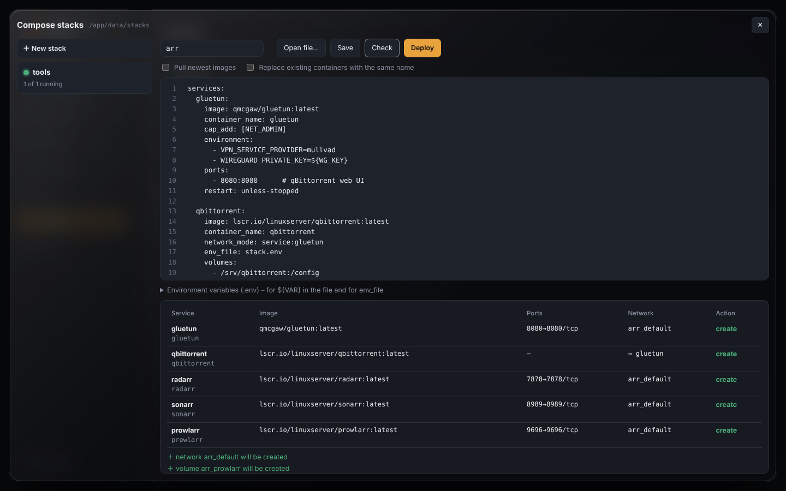

- ArrHub to radi sam preko Docker API-ja – **na Docker hostu ne treba `docker compose`** i radi preko svih načina spajanja (socket proxy, TLS, SSH). Kontejneri dobiju uobičajene compose oznake, pa su grupirani po stacku u Docker tabu i u Portaineru.
- **Varijable okruženja** (polje *.env*) popunjavaju `${VAR}`, `${VAR:-zadano}` i `${VAR:?greška}` u datoteci, a njih učitava i `env_file:` – kao Portainerov `stack.env`.
- **Preuzimanje Portainer stacka:** stackovi pokrenuti negdje drugdje prikazani su pod *Ostali compose projekti*. Klikni ga, zalijepi njegovu datoteku (Portainer: *Stacks → ime → Editor*) i primijeni – kontejneri koji se nisu promijenili rade dalje.
- Kontejneri istog imena koji ne pripadaju nijednom stacku zamjenjuju se samo ako označiš *Zamijeni postojeće kontejnere*. ArrHub nikad ne zamjenjuje vlastiti kontejner.
- *Zaustavi i ukloni kontejnere* gasi stack (po želji i s volumenima); datoteka stacka ostaje dok je ne obrišeš. Datoteke se spremaju u `stacks/` pored `config.json`.
- Podržano: image-i, portovi, volumeni (imenovani, bind s **punom** putanjom, tmpfs), mreže (i vanjske, aliasi, statičke IP adrese), `network_mode` (`service:`, `container:`, `host`), `depends_on` s uvjetima, varijable okruženja, oznake, restart, healthcheck, command/entrypoint, uređaji, `cap_add`, `extra_hosts`, `user`, ograničenja resursa, GPU-i, logging, YAML sidra i `<<` spajanja. Nije podržano: `build:`, `secrets:` / `configs:` i relativne putanje poput `./config` (ArrHub nema mapu na Docker hostu – napiši `/srv/app/config`). Nepodržani ključevi prikazuju se kao upozorenja.

### Nekorišteni image-i

**Image-i** (gumb u Docker tabu) prikazuje sve image-e na Docker hostu s veličinom, starošću i kontejnerima koji ih koriste. Ukloni odabrane ili **sve nekorištene** jednim klikom – image koji koristi bilo koji kontejner (pokrenut ili zaustavljen) nikad se ne može ukloniti.

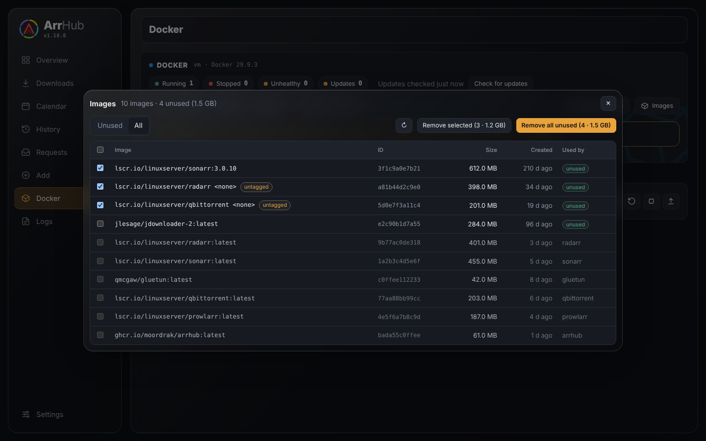

> **Sigurnost:** upravljanje Dockerom znači upravljanje Docker hostom. Uključi prijavu u ArrHub (Postavke → *Prijava*) i učini port 2375 dostupnim samo ArrHubu (npr. pravilom vatrozida na Docker VM-u), nikad s interneta.

## qBittorrent napomena
Ako je u qBittorrentu uključeno *Bypass authentication for clients on localhost / whitelisted subnets*,
korisnik/lozinka mogu ostati prazni. Ako prijava pada s `Fails.`, provjeri da IP ArrHuba nije
zabranjen zbog previše neuspjelih pokušaja (Options → Web UI → ban).

## Pozadine iz knjižnice ne rade?
U Postavkama odaberi *Zid postera* ili *Slike iz knjižnice*. Ispod se pojavi provjera koja za Radarr i Sonarr
pokazuje koliko je slika pronađeno i učitavaju li se.
- **preusmjereno na prijavu (302)**: Radarr/Sonarr za `/MediaCover` traži prijavu. ArrHub tada slike dohvaća s
  TMDB/TVDB-a, pa kontejner treba pristup internetu.
- **Isteklo vrijeme**: vrlo velika knjižnica. Popis se čeka do 90 s, a nakon prvog dohvata pamti se 10 minuta.
- Ako se nijedna slika ne može učitati, prikazuje se Aurora i poruka.

