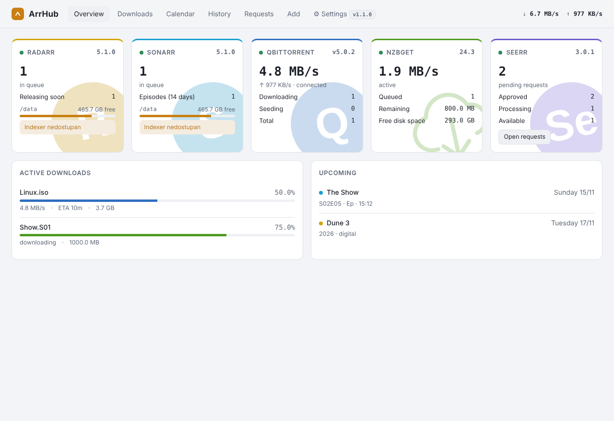
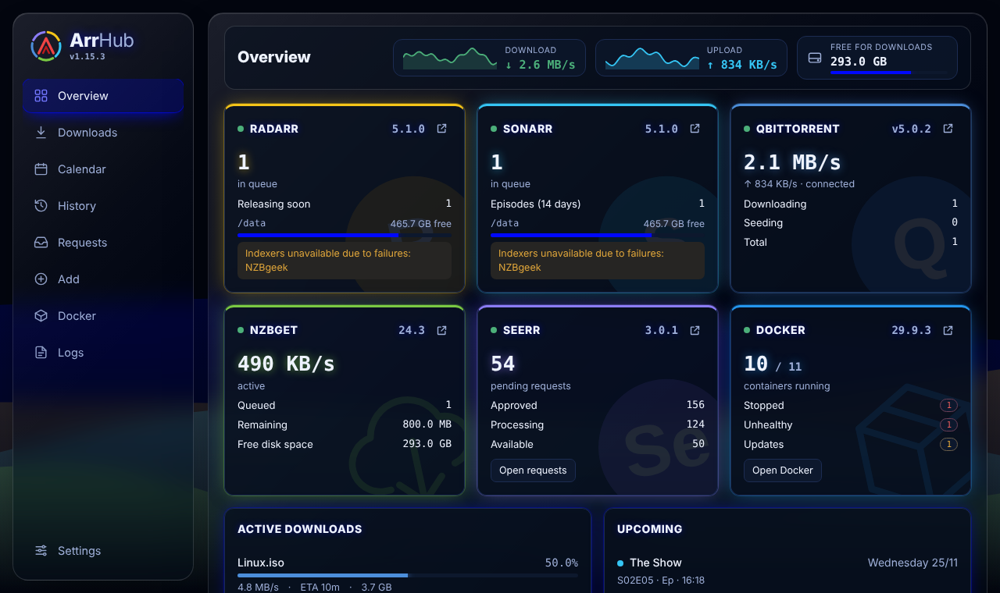
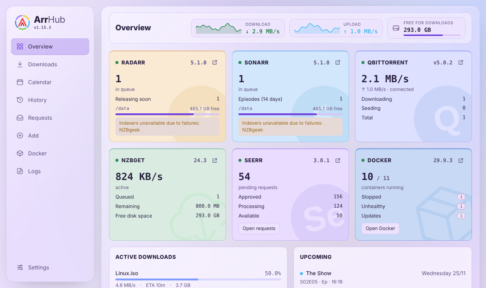
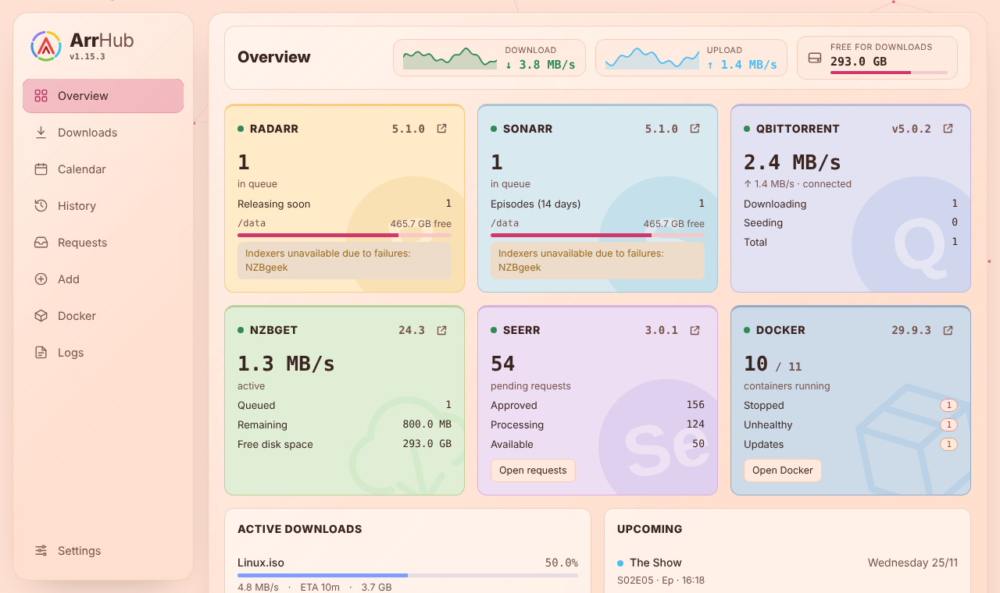
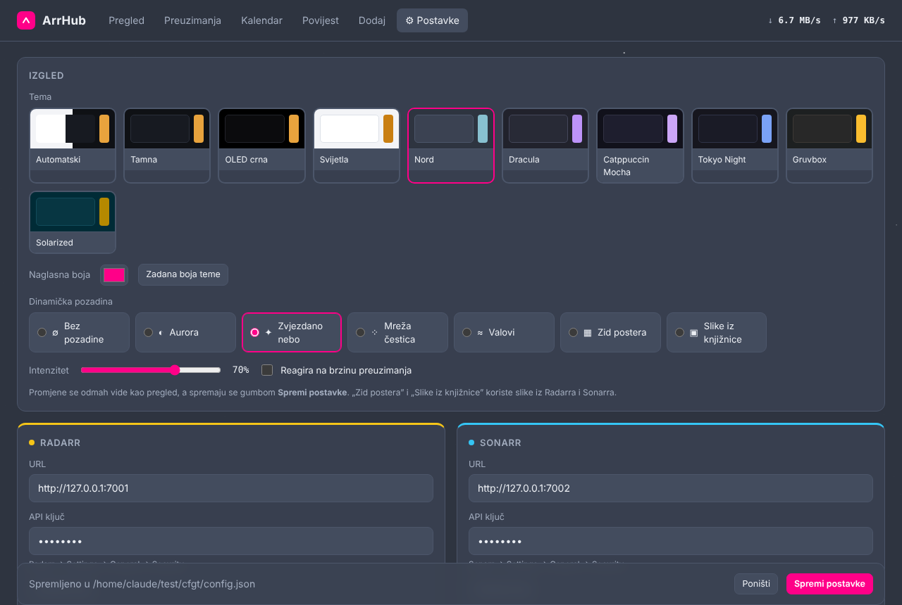

<p align="center">
  <picture>
    <source media="(prefers-color-scheme: dark)" srcset="docs/logo-wordmark-dark.svg">
    
  </picture>
</p>

<p align="center"><b>English</b> · <a href="README.hr.md">Hrvatski</a></p>










One web dashboard for **Radarr, Sonarr, NZBGet, qBittorrent and Seerr**.
A small Node.js server (no dependencies, Node 18+) keeps API keys and passwords on the server side
and proxies the calls, so the browser never sees secrets and there are no CORS problems.

## Features
- **Overview** – status of every service, versions, speeds, free space, health warnings, active downloads and upcoming releases
- **Downloads** – qBittorrent (filter, pause/start, delete with or without files, alternative speed limits),
  NZBGet (pause/resume per item and globally, delete), Radarr/Sonarr queues (remove + blocklist)
- **Requests (Seerr)** – user requests with poster, seasons and status, filters (pending, all, processing, available, declined),
  approve, decline and delete. The pending count is also shown on the Overview. Works with Overseerr and Jellyseerr too.
- **Links to every service** – each card has a ↗ button that opens the service's own web UI in a new tab. By default it uses the service URL; in Settings you can set a separate public link per service (e.g. your reverse-proxy address)
- **Self-signed certificates** – for a service on `https://` with a self-signed or locally signed certificate, tick *Accept self-signed certificate* in Settings. Verification is skipped only for that service's address; everything else (e.g. the GitHub update check) still verifies certificates
- **Offline mode** – Settings → *Network*: ArrHub then talks only to your services – no update check, no images from TMDB/TVDB; posters come from Radarr/Sonarr and Seerr's image cache (also `ARRHUB_OFFLINE=true`)
- **Live header** – every tab shows download and upload speed, each with its own graph of the last minutes, and the free space where your download clients save
- **Docker control** – every container on your Docker host with state, health, CPU/RAM and update status; start, stop, restart, logs and one-click updates with automatic rollback (see [Docker control](#docker-control))
- **Glass layout** – menu on the left and a frosted, 70 % transparent glass frame behind the cards, so the dynamic background shows through; on phones the menu opens with ☰
- **Logs** – read ArrHub's own log and the logs of Radarr, Sonarr, qBittorrent, NZBGet and Seerr in one tab, filter by level, search, auto-refresh and download
- **Own CA certificate** – paste your certificate authority's certificate (PEM) in Settings → *SSL / TLS* and ArrHub fully verifies your `https://` services against it, including the host name. Also `ARRHUB_CA` (PEM text) or `ARRHUB_CA_FILE` (path to a .crt/.pem)
- **Calendar** – movies and episodes for the next 2 weeks
- **History** – latest events from Radarr, Sonarr and NZBGet
- **Add** – search and add movies/series (quality profile and root folder, optionally search right away)
- **Settings** – service URLs, API keys and passwords, ArrHub login, refresh interval and port, all from the UI.
  *Test connection* checks each service before saving, and changes apply immediately without a restart.
- **Themes and dynamic backgrounds** (in Settings): 13 themes (including Matrix, Neon with a glow effect and two colourful pastel themes) + automatic (follows the system light/dark mode), custom
  accent colour and animated backgrounds *Aurora, Starfield, Particle network, Waves, Poster wall* and *Library images*.
  The last two use posters and fanart from Radarr/Sonarr (fetched by ArrHub, no internet needed).
  The animation can speed up with download speed and respects the system “reduce motion” setting.
- **Service icons on cards**: a large, faded service icon behind each card. ArrHub fetches the official icon from your own
  Radarr/Sonarr/qBittorrent/NZBGet/Seerr instance (falls back to a generic icon), with an on/off switch and strength slider in Settings → Appearance
- **Language**: English or Croatian (or automatic from the browser), chosen in Settings → Appearance
- Automatic refresh (5 s by default), optional Basic Auth login
- Supports qBittorrent 4.x and 5.x (stop/start and pause/resume)

## Setup
```bash
node server.js                       # http://<ip>:8686
```
Open the page: if no service is configured yet, the **⚙ Settings** tab opens straight away. Enter the URLs and keys,
click *Test connection* and *Save settings*. Settings are stored in `config.json` (mode 600). Passwords and keys are
never shown in the UI: a field showing `********` means the existing value is kept.




Instead of the UI you can also edit `config.json` by hand (template: `config.example.json`) and restart the service.
Everything can also be set with environment variables: `PORT, ARRHUB_REFRESH, ARRHUB_USER, ARRHUB_PASS, RADARR_URL, RADARR_KEY,
SONARR_URL, SONARR_KEY, NZBGET_URL, NZBGET_USER, NZBGET_PASS, QBIT_URL, QBIT_USER, QBIT_PASS, SEERR_URL, SEERR_KEY`,
the card links `RADARR_LINK, SONARR_LINK, NZBGET_LINK, QBIT_LINK, SEERR_LINK`,
self-signed certificates `RADARR_INSECURE, SONARR_INSECURE, NZBGET_INSECURE, QBIT_INSECURE, SEERR_INSECURE` (`true`/`false`),
own CA `ARRHUB_CA` (PEM) or `ARRHUB_CA_FILE` (path),
offline mode `ARRHUB_OFFLINE` (`true`/`false`),
Docker `ARRHUB_DOCKER_URL`, `ARRHUB_DOCKER_SSH_KEY` / `ARRHUB_DOCKER_SSH_KEY_FILE`, `ARRHUB_DOCKER_CERT_PATH` (or `ARRHUB_DOCKER_CA`, `ARRHUB_DOCKER_CERT`, `ARRHUB_DOCKER_KEY`), `ARRHUB_DOCKER_CLEANUP`, `ARRHUB_DOCKER_LINK`, `ARRHUB_DOCKER_WEB_HOST`, and for the look
`ARRHUB_THEME, ARRHUB_ACCENT, ARRHUB_BACKGROUND, ARRHUB_BG_INTENSITY, ARRHUB_BG_REACTIVE, ARRHUB_LANG` (`en`, `hr`, `auto`),
`ARRHUB_CARD_ICONS` (`true`/`false`), `ARRHUB_CARD_ICON_STRENGTH` (3–30).
They take precedence over the file, so those fields are locked in Settings. `ARRHUB_CONFIG` changes the file path.

> ⚠ Without a login, anyone who can open ArrHub can also change its settings. If it is reachable outside your LAN, enable the login.

### Proxmox — automatic install (recommended)
On the Proxmox host, as root:
```bash
bash -c "$(curl -fsSL https://raw.githubusercontent.com/moordrak/arrhub/main/proxmox/arrhub-lxc.sh)"
```
The script asks for the container settings (ID, RAM, disk, storage, bridge, VLAN, static IP or DHCP), the language and
the service URLs and keys. It then creates an unprivileged Debian LXC (Debian 13 on PVE 9+, otherwise 12),
installs Node.js and ArrHub and runs it as a systemd service. Press Enter to skip services you don't use; everything can be changed later in Settings.

Unattended, e.g. for automation:
```bash
NONINTERACTIVE=1 CTID=120 CT_IP=192.168.1.50/24 CT_GW=192.168.1.1 ARRHUB_LANG=en \
RADARR_URL=http://192.168.1.10:7878 RADARR_KEY=xxx \
QBIT_URL=http://192.168.1.10:8080 QBIT_USER=admin QBIT_PASS=xxx \
bash proxmox/arrhub-lxc.sh
```
Container variables: `CTID, CT_NAME, CT_CORES, CT_RAM, CT_DISK, CT_STORAGE, TPL_STORAGE, CT_BRIDGE, CT_VLAN, CT_IP, CT_GW, CT_PASS`.

### Existing LXC or Debian/Ubuntu server
Inside the container or on the server, as root:
```bash
bash -c "$(curl -fsSL https://raw.githubusercontent.com/moordrak/arrhub/main/install.sh)"
```
Installs into `/opt/arrhub`, creates the `arrhub` user and the `arrhub.service` unit.

### Upgrade
Run `install.sh` again (the existing `config.json` is kept). From the Proxmox host:
```bash
pct exec <CTID> -- bash -c "$(curl -fsSL https://raw.githubusercontent.com/moordrak/arrhub/main/install.sh)"
```

### Manual (systemd)
```bash
useradd -r -s /usr/sbin/nologin arrhub
mkdir -p /opt/arrhub && cp -r server.js public config.json /opt/arrhub/
chown -R arrhub: /opt/arrhub && chmod 600 /opt/arrhub/config.json
cp arrhub.service /etc/systemd/system/ && systemctl enable --now arrhub
```

### Docker
Prebuilt multi-arch images (amd64, arm64) are published to GitHub Container Registry:
```bash
docker run -d --name arrhub --restart unless-stopped \
  -p 8686:8686 -v arrhub-data:/app/data \
  ghcr.io/moordrak/arrhub:latest
```
or with Compose (`docker-compose.yml` in this repo):
```bash
docker compose up -d
```
The configuration lives in the `arrhub-data` volume (`/app/data/config.json`) and is edited from Settings.

Tags: `latest` (latest release), `1.0.0` / `1.0` / `1` (versions), `edge` (latest commit on `main`).

Releases are automatic: bump `version` in `package.json` (optionally add `.github/releases/vX.Y.Z.md` with release notes) and push to `main` –
the workflow builds the images, creates the `vX.Y.Z` tag and publishes the GitHub release.
To build it yourself: `docker build -t arrhub .`

### Nginx Proxy Manager
Add a Proxy Host → `http://<lxc-ip>:8686`. If it is reachable outside your LAN, make sure to enable the
`auth` login in config.json or an Access List in NPM – the dashboard can delete and add content.

## Docker control

The **Docker** tab shows every container on your Docker host – grouped by compose project – with its state, health, uptime, CPU and RAM, ports and whether a newer image is available. You can start, stop and restart containers, read their logs and **update** them one by one or all at once.

**Updating** works like Watchtower, but only when you click: the Docker host pulls the new image, then ArrHub recreates the container with exactly the same settings (environment, volumes, networks and aliases, ports, labels, restart policy). If the new container does not keep running (or reports itself unhealthy), the old one is put back automatically. Containers that share another container's network (e.g. qBittorrent behind a VPN container with `network_mode: service:vpn`) are recreated along with it. Images pinned to a digest are left alone. The update check is done by the Docker host, so ArrHub itself still does not go to the internet in offline mode.

**Setup (recommended): a socket proxy on the Docker host.** It gives ArrHub only the parts of the Docker API it needs instead of the full socket. Add it to the compose file on your Docker VM:

```yaml
services:
  socket-proxy:
    image: lscr.io/linuxserver/socket-proxy:latest
    container_name: socket-proxy
    environment:
      - CONTAINERS=1
      - IMAGES=1
      - NETWORKS=1
      - DISTRIBUTION=1
      - INFO=1
      - POST=1
      - ALLOW_START=1
      - ALLOW_STOP=1
      - ALLOW_RESTARTS=1
      - ALLOW_LOGS=1
      - EXEC=1            # only for the terminal – remove if you don't want it
    volumes:
      - /var/run/docker.sock:/var/run/docker.sock:ro
    ports:
      - 2375:2375
    read_only: true
    tmpfs:
      - /run
    restart: unless-stopped
```

Then in ArrHub → **Settings → Docker** enter `http://<docker-vm-ip>:2375` and click *Test connection*. Alternatives: `https://<host>:2376` with TLS client certificates (paste `ca.pem`, `cert.pem` and `key.pem`, or set `ARRHUB_DOCKER_CERT_PATH`), or `unix:///var/run/docker.sock` when ArrHub runs on the Docker host itself.

**Or over SSH – no open port.** ArrHub connects with an SSH key and runs only `docker system dial-stdio` on the Docker host (the same thing `DOCKER_HOST=ssh://…` does):

1. In ArrHub → **Settings → Docker** enter `ssh://arrhub@<docker-vm-ip>`, open *SSH* and click **Generate key pair** – ArrHub fills in a new key and shows a ready line for `authorized_keys`.
2. Click **Copy** under that line, then on the Docker VM add it for a user in the `docker` group – paste **your copied line** in place of `PASTE_THE_LINE_FROM_ARRHUB_HERE` (it is about 130 characters long and starts with `command="docker system dial-stdio",restrict ssh-ed25519 AAAAC3Nza…`):
   ```bash
   sudo adduser --disabled-password --gecos "" arrhub && sudo usermod -aG docker arrhub
   sudo install -d -m 700 -o arrhub -g arrhub /home/arrhub/.ssh
   echo 'PASTE_THE_LINE_FROM_ARRHUB_HERE' | sudo tee -a /home/arrhub/.ssh/authorized_keys
   sudo chown arrhub:arrhub /home/arrhub/.ssh/authorized_keys && sudo chmod 600 /home/arrhub/.ssh/authorized_keys
   ```
   `command=…` and `restrict` limit the key to the Docker API – it cannot open a shell or forward ports.
3. Save the settings and click *Test connection*.

The Docker host's SSH key is trusted on the first connection and remembered in `docker_known_hosts` next to `config.json`; a changed key is refused. Keys with a passphrase are not supported. Environment variables: `ARRHUB_DOCKER_URL=ssh://…`, `ARRHUB_DOCKER_SSH_KEY` or `ARRHUB_DOCKER_SSH_KEY_FILE`. Note: a user in the `docker` group can do everything Docker can – the socket proxy is the more limited option.

**Web pages and terminal.** Containers with a published TCP port (or a `arrhub.url` / `homepage.href` label) get a 🌐 button that opens the app in a window over ArrHub. Apps that forbid being shown inside another page (e.g. qBittorrent with its clickjacking protection on) and plain `http://` pages while ArrHub itself runs on `https://` are offered in a new tab instead. If the links use the wrong address, set *Address for opening containers* in Settings → Docker.

The **Terminal** button opens a shell **inside** the container (`docker exec`, bash or sh) – e.g. directly in Radarr, not on the Docker host. It works over every connection type; with the socket proxy add `EXEC=1` (this allows a root shell in any container – leave it out if you don't want the terminal). Behind Nginx Proxy Manager turn on *Websockets Support* for the ArrHub proxy host.

> **Security:** control over Docker means control over the Docker host. Turn on the ArrHub login (Settings → *Login*), and make port 2375 reachable only from ArrHub (e.g. a firewall rule on the Docker VM), never from the internet.

## qBittorrent note
If *Bypass authentication for clients on localhost / whitelisted subnets* is enabled in qBittorrent,
username/password can stay empty. If login fails with `Fails.`, check that ArrHub's IP has not been
banned after too many failed attempts (Options → Web UI → ban).

## Library backgrounds not working?
In Settings choose *Poster wall* or *Library images*. A check appears below showing, for Radarr and Sonarr,
how many images were found and whether they load.
- **redirected to login (302)**: Radarr/Sonarr requires a login for `/MediaCover`. ArrHub then fetches the images from
  TMDB/TVDB, so the container needs internet access.
- **Timed out**: very large library. The list is awaited for up to 90 s and cached for 10 minutes after the first fetch.
- If no image can be loaded at all, Aurora is shown together with a message.
