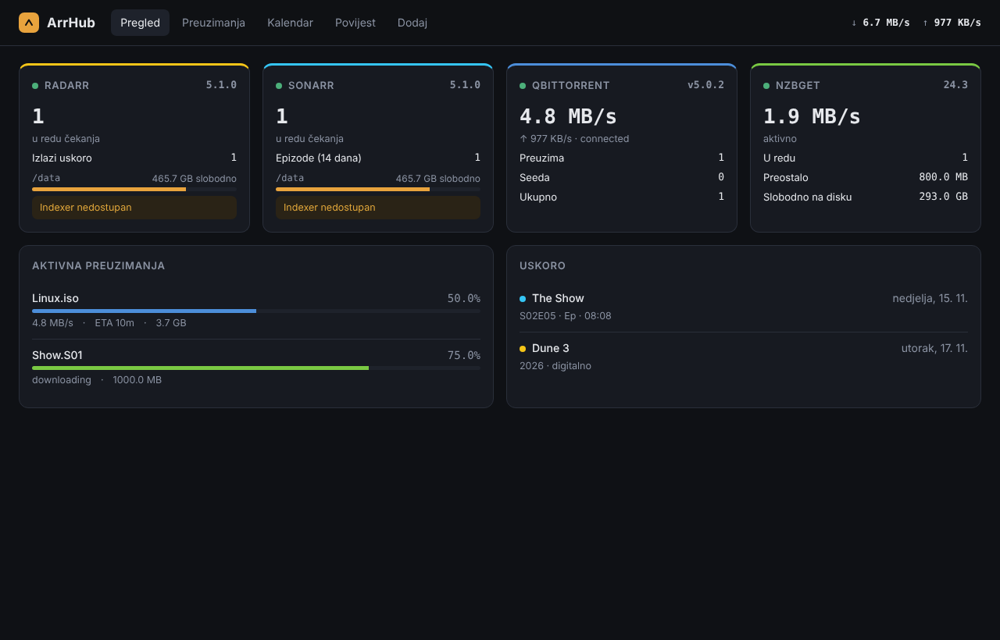
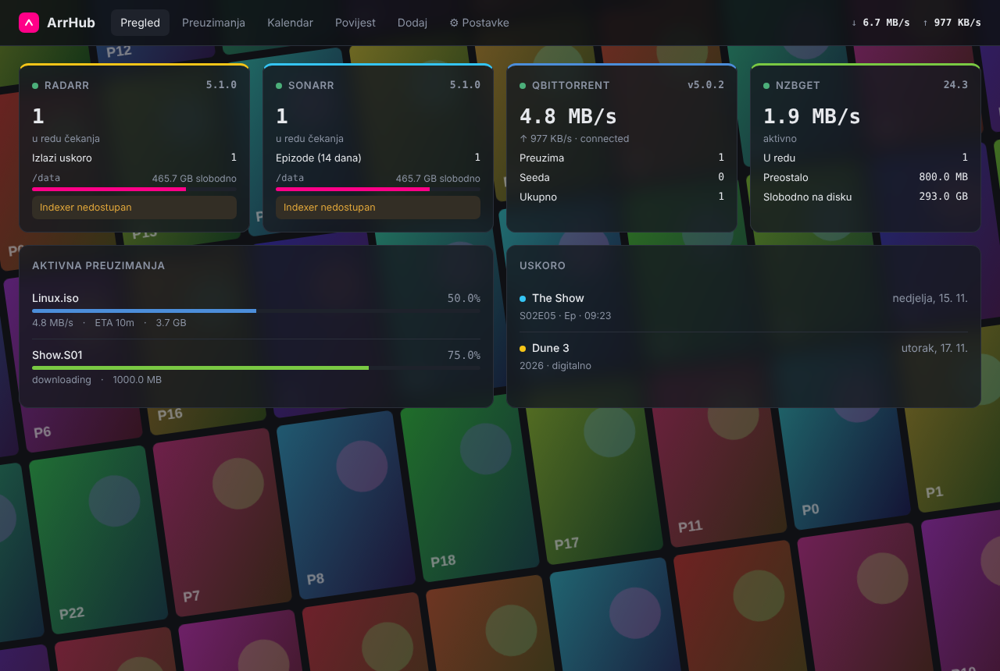
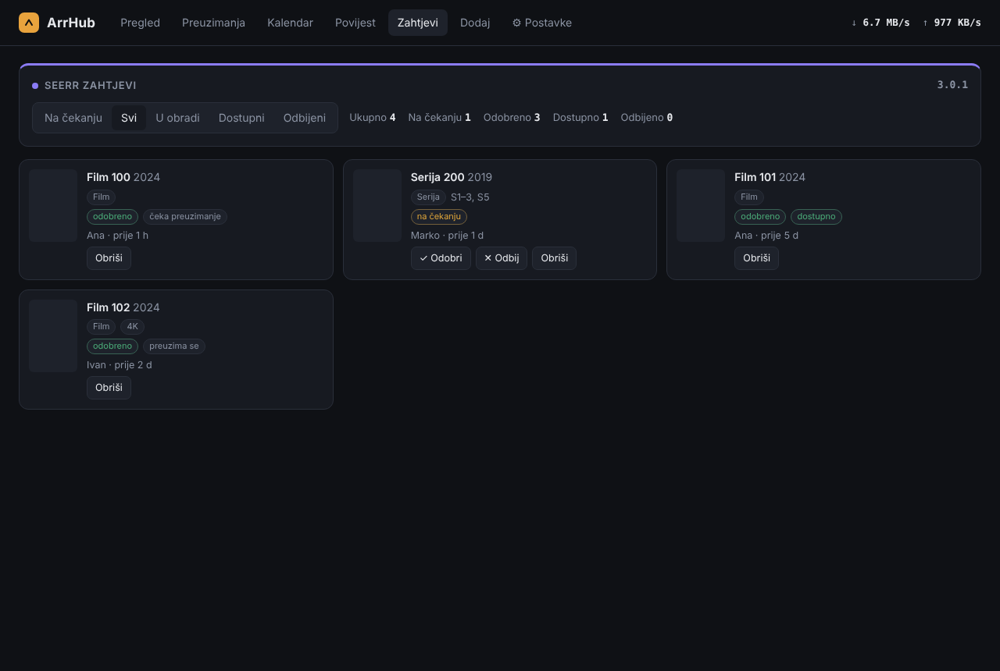

# ArrHub





Jedinstvena web nadzorna ploča za **Radarr, Sonarr, NZBGet, qBittorrent i Seerr**.
Mali Node.js poslužitelj (bez ovisnosti, Node 18+) drži API ključeve i lozinke na strani poslužitelja
i prosljeđuje pozive, pa preglednik nikad ne vidi tajne i nema CORS problema.

## Mogućnosti
- **Pregled** – stanje svih usluga, verzije, brzine, slobodan prostor, health upozorenja, aktivna preuzimanja i nadolazeća izdanja
- **Preuzimanja** – qBittorrent (filter, pauza/pokretanje, brisanje s/bez datoteka, alt. ograničenje brzine),
  NZBGet (pauza/nastavak po stavci i globalno, brisanje), Radarr/Sonarr red čekanja (uklanjanje + blocklist)
- **Zahtjevi (Seerr)** – zahtjevi korisnika s posterom, sezonama i stanjem, filtri (na čekanju, svi, u obradi, dostupni, odbijeni),
  odobravanje, odbijanje i brisanje. Broj zahtjeva na čekanju vidi se i u Pregledu. Radi i s Overseerrom i Jellyseerrom.
- **Kalendar** – filmovi i epizode za sljedeća 2 tjedna
- **Povijest** – zadnji događaji iz Radarra, Sonarra i NZBGeta
- **Dodaj** – pretraga i dodavanje filmova/serija (odabir profila kvalitete i mape, opcionalno odmah traži)
- **Postavke** – adrese, API ključevi i lozinke usluga, prijava u ArrHub, interval osvježavanja i port, sve kroz sučelje.
  Gumb *Testiraj vezu* provjerava svaku uslugu prije spremanja, a promjene vrijede odmah, bez ponovnog pokretanja.
- **Teme i dinamičke pozadine** (u Postavkama): 9 tema + automatska (prati svijetli/tamni način sustava), vlastita
  naglasna boja te animirane pozadine *Aurora, Zvjezdano nebo, Mreža čestica, Valovi, Zid postera* i *Slike iz knjižnice*.
  Zadnje dvije koriste postere i pozadinske slike iz Radarra/Sonarra (dohvaća ih ArrHub, nije potreban internet).
  Animacija se po želji ubrzava s brzinom preuzimanja, a poštuje i postavku sustava „smanji pokrete”.
- Automatsko osvježavanje (zadano 5 s), opcionalna Basic Auth prijava
- Podržava qBittorrent 4.x i 5.x (stop/start i pause/resume)

## Postavljanje
```bash
node server.js                       # http://<ip>:8686
```
Otvori stranicu: ako nijedna usluga nije podešena, odmah se otvara kartica **⚙ Postavke**. Upiši adrese i ključeve,
klikni *Testiraj vezu* i *Spremi postavke*. Postavke se spremaju u `config.json` (prava 600). Lozinke i ključevi se u
sučelju nikad ne prikazuju: polje s `********` znači da se postojeća vrijednost zadržava.




Umjesto sučelja možeš i ručno urediti `config.json` (predložak je `config.example.json`) i ponovno pokrenuti servis.
Sve se može zadati i varijablama okruženja: `PORT, ARRHUB_REFRESH, ARRHUB_USER, ARRHUB_PASS, RADARR_URL, RADARR_KEY,
SONARR_URL, SONARR_KEY, NZBGET_URL, NZBGET_USER, NZBGET_PASS, QBIT_URL, QBIT_USER, QBIT_PASS, SEERR_URL, SEERR_KEY`, a za izgled
`ARRHUB_THEME, ARRHUB_ACCENT, ARRHUB_BACKGROUND, ARRHUB_BG_INTENSITY, ARRHUB_BG_REACTIVE`. One imaju prednost pred
datotekom, pa su takva polja u Postavkama zaključana. Putanju datoteke mijenja `ARRHUB_CONFIG`.

> ⚠ Bez prijave svatko tko može otvoriti ArrHub može i mijenjati postavke. Ako je dostupan izvan LAN-a, uključi prijavu.

### Proxmox — automatska instalacija (preporučeno)
Na Proxmox hostu, kao root:
```bash
bash -c "$(curl -fsSL https://raw.githubusercontent.com/moordrak/arrhub/main/proxmox/arrhub-lxc.sh)"
```
Skripta pita za postavke kontejnera (ID, RAM, disk, storage, bridge, VLAN, statična IP ili DHCP) i
za adrese i ključeve usluga. Zatim stvara neprivilegirani Debian LXC (Debian 13 na PVE 9+, inače 12),
instalira Node.js i ArrHub te ga pokreće kao systemd servis. Usluge koje ne koristiš preskoči s Enter. Sve se kasnije može promijeniti u Postavkama.

Bez pitanja, npr. za automatizaciju:
```bash
NONINTERACTIVE=1 CTID=120 CT_IP=192.168.1.50/24 CT_GW=192.168.1.1 \
RADARR_URL=http://192.168.1.10:7878 RADARR_KEY=xxx \
QBIT_URL=http://192.168.1.10:8080 QBIT_USER=admin QBIT_PASS=xxx \
bash proxmox/arrhub-lxc.sh
```
Varijable kontejnera: `CTID, CT_NAME, CT_CORES, CT_RAM, CT_DISK, CT_STORAGE, TPL_STORAGE, CT_BRIDGE, CT_VLAN, CT_IP, CT_GW, CT_PASS`.

### Postojeći LXC ili Debian/Ubuntu poslužitelj
Unutar kontejnera ili na poslužitelju, kao root:
```bash
bash -c "$(curl -fsSL https://raw.githubusercontent.com/moordrak/arrhub/main/install.sh)"
```
Instalira u `/opt/arrhub`, stvara korisnika `arrhub` i servis `arrhub.service`.

### Nadogradnja
Ponovno pokreni `install.sh` (postojeći `config.json` se zadržava). S Proxmox hosta:
```bash
pct exec <CTID> -- bash -c "$(curl -fsSL https://raw.githubusercontent.com/moordrak/arrhub/main/install.sh)"
```

### Ručno (systemd)
```bash
useradd -r -s /usr/sbin/nologin arrhub
mkdir -p /opt/arrhub && cp -r server.js public config.json /opt/arrhub/
chown -R arrhub: /opt/arrhub && chmod 600 /opt/arrhub/config.json
cp arrhub.service /etc/systemd/system/ && systemctl enable --now arrhub
```

### Docker
```bash
docker compose up -d --build
```
Konfiguracija se čuva u volumenu `arrhub-data` (`/app/data/config.json`) i uređuje se kroz Postavke.

### Nginx Proxy Manager
Dodaj Proxy Host → `http://<ip-lxc>:8686`. Ako je dostupno izvan LAN-a, obavezno uključi
`auth` u config.json ili Access List u NPM-u – ploča može brisati i dodavati sadržaj.

## qBittorrent napomena
Ako je u qBittorrentu uključeno *Bypass authentication for clients on localhost / whitelisted subnets*,
korisnik/lozinka mogu ostati prazni. Ako prijava pada s `Fails.`, provjeri da IP ArrHuba nije
zabranjen zbog previše neuspjelih pokušaja (Options → Web UI → ban).

## Pozadine iz knjižnice ne rade?
U Postavkama odaberi *Zid postera* ili *Slike iz knjižnice*. Ispod se pojavi provjera koja za Radarr i Sonarr
pokazuje koliko je slika pronađeno i učitavaju li se.
- **preusmjereno na prijavu (302)**: Radarr/Sonarr za `/MediaCover` traži prijavu. ArrHub tada slike dohvaća s
  TMDB/TVDB-a, pa kontejner treba pristup internetu.
- **Isteklo vrijeme**: vrlo velika knjižnica. Popis se čeka do 90 s, a nakon prvog dohvata pamti se 10 minuta.
- Ako se nijedna slika ne može učitati, prikazuje se Aurora i poruka.

